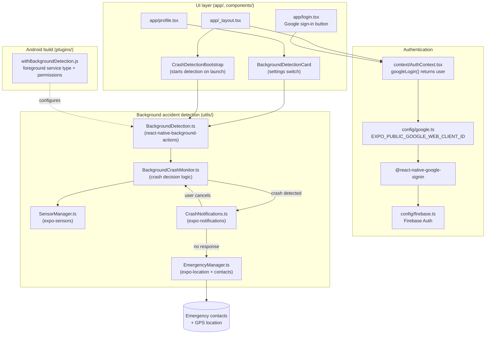

# LifeLink — changes (extract over your project folder)

Extract this zip INTO your project root (D:\ProjectsMain\LifeLink) and allow overwrite.
It only contains files that changed, so your newer files (config/firebase.ts,
profile.tsx, etc.) are not touched.

## Architecture

LifeLink is an Expo / React Native app. Authentication and background accident
detection are separate layers, both mounted from the root layout.

### Flow
1. **Sign-in:** `login.tsx` calls `AuthContext.googleLogin()`, which uses the Google web client ID from `config/google.ts`, signs in via Google Sign-In, and authenticates with Firebase. It returns the user.
2. **Startup:** `_layout.tsx` mounts `CrashDetectionBootstrap`, which restores the saved setting and starts the background service if it is enabled.
3. **Monitoring:** `BackgroundDetection` runs a foreground service. `BackgroundCrashMonitor` reads `SensorManager` data and decides when a crash has happened.
4. **Response:** `CrashNotifications` alerts the user with a countdown. If the user doesn't cancel, `EmergencyManager` fetches the location and notifies emergency contacts.
5. **Control:** `BackgroundDetectionCard` on the Profile screen toggles the whole feature.

### Expo Go vs. dev build
| Feature | Expo Go | Dev build (EAS) |
|---|---|---|
| Google button | Shown, explains app build is needed | Works |
| Background detection | Switch disabled with message | Works |

## Files
- app/login.tsx                    Google button (Expo-Go safe)
- context/AuthContext.tsx          googleLogin now returns the user
- config/google.ts                 reads EXPO_PUBLIC_GOOGLE_WEB_CLIENT_ID
- plugins/withBackgroundDetection.js   Android manifest setup (service type + permissions)
- utils/BackgroundCrashMonitor.ts, BackgroundDetection.ts, CrashNotifications.ts,
  EmergencyManager.ts, SensorManager.ts   background accident detection
- components/BackgroundDetectionCard.tsx, CrashDetectionBootstrap.tsx
- app.json                         MERGE, don't blindly overwrite if you changed yours:
    * android.googleServicesFile = ./google-services.json
    * ios.bundleIdentifier = com.charanachanta2.LifeLink
    * plugins += "@react-native-google-signin/google-signin", "./plugins/withBackgroundDetection"

## app/_layout.tsx and app/profile.tsx (edits already applied)
Both files are included with the two additions done (<CrashDetectionBootstrap />
in _layout, <BackgroundDetectionCard /> in profile, above Emergency Contacts).
They are based on the project zip you sent. If your local copies have extra
changes, merge just those lines instead of overwriting.

## Install (once)
   npx expo install @react-native-google-signin/google-signin
   (expo-notifications, expo-location, expo-sensors, expo-constants,
    @react-native-async-storage/async-storage and react-native-background-actions
    are already in your package.json)

## Build (once, after Firebase setup)
   eas build --platform android --profile development
   then: npx expo start --dev-client

## Expo Go
Works without errors: Google button shows (tap explains it needs the app build);
Settings card shows the background switch disabled with a message.

## Safety check ("Are you OK? tap within 10 seconds")  - NEW
Crash detected (app open OR closed) -> "Are you OK?" notification with
[I'm OK] / [Send help now] buttons, plus a full-screen prompt if the app is open.
No answer in 10 s -> emergency contacts are emailed.

New:      components/CrashCheckOverlay.tsx
Changed:  utils/CrashNotifications.ts, utils/EmergencyManager.ts,
          components/CrashDetectionBootstrap.tsx, components/BackgroundDetectionCard.tsx
Needs the matching backend update (POST /api/emergency/crash-check, /:id/confirm).
Test it without a crash: Settings -> "Test the safety check" (sends nothing).
